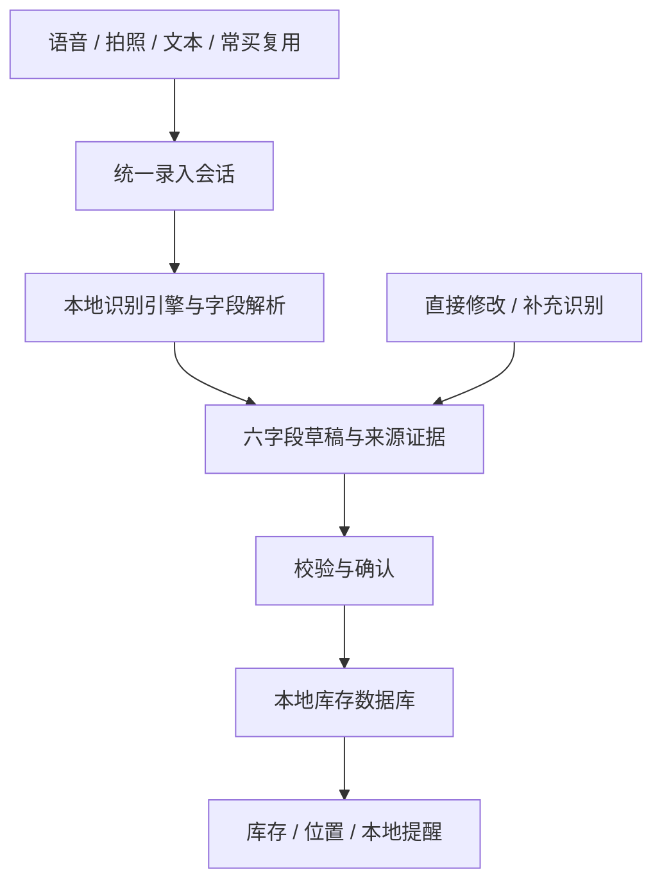

# 食物管家：离线智能录入与 UI 整体重构方案

日期：2026-10-10（北京时间）  
状态：供决策的方案，尚未执行应用代码改造。  
范围：智能识别、录入与编辑流程、库存与位置页面、视觉规范、共享状态和验收。保留现有库存、提醒、归档及恢复能力。

## 1. 推荐方向与要求

推荐采用：**完全离线的智能填写 + 一张六字段确认卡 + 以库存为首页的简洁界面**。

六项核心信息：食物名称、数量、单位、存放位置、到期日期或个人提醒日期、食物大类。保质期时长是日期的另一种录入依据，不能直接当成到期日期。

约束：

- 不引入服务端、联网商品库或条码扫描。模型及运行组件随安装包提供，首次使用也不依赖下载。
- 一次智能输入正确自动填写至少四项，作为效果验收门槛；不能用手工补填、无依据默认值或错误字段凑数。
- 录入最多三个流程阶段：智能输入、同屏核对补全、保存。没有额外的方式选择向导、识别报告页或独立手工补录页。
- 三个阶段不等于总共三次点击。另行记录点击数、输入次数和完成耗时，避免用页面数量掩盖复杂操作。
- 支持水果、散装食品、包装食品及剩菜；不能仅围绕包装文字设计。
- 常买物品直接复用，不强制拍照或说话；每批次数量、日期重新处理。
- 识别结果可直接修改；补充识别保留手工修改；保存失败保留草稿。

## 2. 主流应用参考及适用边界

以下参照来自官方产品资料。借鉴的是操作模式，不据此声称这些应用的识别准确率、离线能力或市场排名。

| 参考 | 官方描述的模式 | 本项目采用的设计 |
|---|---|---|
| Todoist 快速添加 | 一次输入任务及日期等属性，快捷添加界面承载相关操作 | 一句话填写多字段；字段结果立即可见；输入和补充保持在同一个会话 |
| Samsung Food Food List | 手工或照片添加食品，点击物品编辑位置和 use-by date | 拍照后直接核对草稿；位置、日期可直接点选；列表进入同一套编辑控件 |
| NoWaste | 汇总冰箱、冷冻、食品柜库存，支持搜索、排序、筛选和到期日视图 | 默认显示库存和待处理状态；位置是重要筛选维度；日期优先排序 |
| Android Material 与无障碍规范 | 原生导航、日期选择和触摸目标规范 | 保留 Compose/Material 3，统一组件；交互目标至少 48dp；支持大字体和读屏 |

来源：

- [Todoist 快速添加](https://www.todoist.com/help/todoist/features/use-task-quick-add-in-todoist-va4Lhpzz)
- [Samsung Food 食品清单](https://support.samsungfood.com/hc/en-us/articles/30025317487508-Getting-Started-with-Food-List)
- [NoWaste 官方介绍](https://www.nowasteapp.com/home/)
- [Android 触摸目标规范](https://support.google.com/accessibility/android/answer/7101858)

## 3. 当前项目与重构重点

以本轮读取的当前代码为准；2026-10-01 综合评估中的历史缺陷不能直接视为仍未修复。

| 当前事实 | 重构重点 |
|---|---|
| 现有底部为首页、库存、录入、设置，首页与库存都承载库存状态和添加入口 | 合并重复展示，首页直接面向库存和待处理食品 |
| 库存顶部加号进入拍照，悬浮添加进入另一套新增编辑入口 | 所有新增入口进入统一录入会话，只改变初始输入方式 |
| ScanScreen 内分别展示拍照、语音和手工组件；草稿卡需要展开编辑 | 六字段直接可编辑，不再先读长摘要再展开完整表单 |
| 草稿缺失提示目前主要覆盖名称、数量、日期、位置 | 六字段均参与完整度计算，数量和单位分别检查 |
| OCR 主要保留整段文本，原图与增强图结果按行合并 | 保留文字位置与来源，按区域核对日期，避免矛盾数字混成一个结论 |
| 食品识物、可见物品计数尚不是现有 OCR 的能力 | 增加本地食品目标检测，不能只换一个入口名称 |
| FoodDraft 已有保护字段和日期推导标记，但缺少六字段统一的来源、候选和状态 | 建立统一草稿及逐字段证据结构，支持直接修改和补充合并 |
| 当前数据、OCR 和 Vosk 语音均采用本地能力；清单显式移除网络权限 | 保留离线架构，验收最终安装包和首次离线运行 |

## 4. 页面结构和视觉风格

### 4.1 信息结构

建议底部四个页面：**食物、录入、位置、设置**。

- 食物：合并当前首页与库存，作为默认首页。
- 录入：常买复用、语音、拍照和直接填写共用一个页面。
- 位置：看各存放位置的食品，管理位置名称及别名。
- 设置：提醒、常用品管理、归档恢复、帮助和本地数据设置。

保留现有功能的访问路径，统计缩为食物页摘要或二级视图，不占单独首页。位置筛选保留在食物页，不强迫用户切页。

### 4.2 食物首页

从上到下：

1. 页面标题和搜索框。
2. 紧凑状态筛选：全部、需处理、未设置日期。需处理再区分过期、临期、个人提醒已到。
3. 位置、大类和排序入口；显示当前筛选，并支持一键清除。
4. 食品列表：名称突出，数量单位、位置、日期次之。
5. 易触达的语音、拍照入口；常买物品在录入页直接可点，不以三个大卡片占据库存首屏。

默认排序建议优先显示需要处理的记录，再按日期排序；未设置日期单独可筛选。个人提醒到日不能显示成食品已过期。

列表使用三行左右的紧凑信息：

```text
牛奶                         2 盒
冰箱冷藏 · 乳制品
到期 2026-10-25 · 距到期 15 天
```

相同名称但日期、位置或单位不同的记录保留为不同批次，不自动合并。不同单位的数量不能直接相加。

点击整行进入详情/编辑；点击数量快速修改余量。更多菜单提供用完、丢弃、移动位置和删除，避免每条常驻一排按钮。可逆的归档和移动提供撤销；永久删除仍确认。手势仅作为辅助，保留可见的操作入口。

### 4.3 六字段确认卡

建议四行紧凑布局：

```text
自动填入 4/6 项 · 待补：位置、日期

食物名称               牛奶
数量   2               单位   盒
食物大类   乳制品       存放位置   点选
日期   点选到期日 / 提醒日

补一句话     补拍照片             保存
```

六字段直接可编辑。标准字体、正常手机宽度下优先让六字段同屏；大字体或键盘展开时允许滚动，不压缩文字和触摸区域来强求同屏。

有依据的大类映射直接填入并可修改，例如牛奶→乳制品；不要求每个已填字段再点一次确认。不确定的名称或日期提供少量候选。首次默认收起识别原文和详细诊断，用户需要时展开。

### 4.4 视觉规范

- 继续使用现有暖橙主色、米色背景和原生 Material 3，减少大面积彩色卡片、厚阴影和装饰。
- 主色用于当前选择和主要操作；绿色用于正常状态，琥珀色用于待确认/临期，红色用于过期或明确错误。必须配合文字，不只用颜色表达。
- 标题约 22–24sp，核心字段值约 16sp，标签与状态约 14sp；辅助说明可更小，但不把核心信息降为 11sp。
- 统一 4/8/12/16/24dp 间距；圆角集中为少量规格；按状态统一按钮、输入框和卡片样式。
- 核心触摸区域至少 48dp。录音支持点击开始/结束，按住说话可保留为可选操作。
- 支持浅深主题、大字体、TalkBack、长名称及小屏。保存按钮与键盘保持可达，不遮挡正在编辑的字段。
- 不在面向用户的主页面展示模型名、调试命中规则或未经校准的准确率百分比。

## 5. 三阶段录入与纠错

### 阶段一：智能输入

- 点击语音直接进入录音操作；点击拍照直接进入拍摄，不先进入方式选择向导。首次系统权限弹窗是操作系统要求，不计作人为设计的额外流程页面，但应记录首次完成成本。
- 常买物品点名称，带出经确认的名称、单位、大类。常用位置标明来自历史，本批次日期不沿用。
- 用户也可输入一句文本，使用同一解析模块；不会因为不用语音而失去智能填写。
- 识别耗时中显示“正在识别”，允许取消；结果回到同一张确认卡。

### 阶段二：同屏核对补全

- 自动填入的值正常显示，来源在需要时可查看。
- 候选冲突显示“待确认”，如生产日/到期日含义不明；直接点选候选或填写日期。
- 空缺显示“待补充”，位置和大类使用常用选项，数量使用数字键盘，单位可选也可输入。
- 补充语音只处理目标或缺失字段；明确的“改成”命令可以提出替换。已手改字段受到保护，替换需要明确操作。
- 多物品输入生成多张紧凑草稿卡，每张独立显示缺失项；顶部汇总待处理条数。共享位置只在用户选择“应用到本批”后使用。

### 阶段三：保存

- 六项按用户要求完成核对后保存；日期可为包装到期日或明确的个人提醒日。
- 用户确实不知道日期时，可明确选择“暂不设置”；这属于已处理的空缺，不能算成日期识别成功，也不产生到期提醒。
- 多条录入一次保存已完成条目，未完成条目保留；若采用一次事务保存某组条目，应明确成功范围，避免重试重复。
- 保存成功显示名称及条数，支持继续录入；仅在数据库确认成功后清除对应草稿。
- 保存失败保留全部内容并给出重试入口。退出、旋转、应用回到前台后恢复草稿和当前编辑位置。

### 日期控件

一个日期入口、按需要展开三种方式：直接选到期日；生产日期+保质期时长；个人提醒日。

日历支持数字输入年月日及便捷年月切换，选完展示完整年月日和相对天数。保质期月/年按日历计算。未知生产日期不能默认今天；未明确年份、日期角色冲突时保留候选。包装日期、推算日期和个人提醒的来源及含义必须不同。

## 6. 完全离线智能方案

### 6.1 语音优先

管线：本地语音识别→字段解析→食品/单位/位置词库→候选与冲突处理→统一草稿。

先保留现有 Vosk，分别衡量转写错误和解析错误。若真实转写样本未达标，再对比更合适的本地中文模型；模型选择依据同一批录音，不能只根据模型参数量下结论。

重点覆盖：中文数量、小数、斤/公斤等单位、名称别名、自定义位置、明确到期日、相对日期和生产日+保质期关系。采购时间与生产时间、包装净含量与库存数量分别处理。

示例“买了两盒牛奶，放冰箱冷藏，10月25日到期”：目标填写名称、数量、单位、位置、日期，并按名称映射大类。复杂多食品语句先分段、再分别绑定数量和日期，不把一条食品的日期广播到其他食品。

### 6.2 拍照识物与 OCR 协作

管线：整图方向校正→本地食品目标检测/识物→可见物品计数；并行 OCR 读取包装→日期区域细读→证据合并→统一草稿。

- 裸露食物：专用食品模型提供名称与大类；可完整辨认的物品才计数。单位依任务和可见包装判断，不使用一个通用“个”掩盖不确定性。
- 包装食品：OCR 读取名称、日期和包装文字，视觉分类辅助判断食品类型。包装净含量另作可选规格，不冒充库存数量。
- 日期：保留文字框及邻近说明，从原始照片裁出候选区域细读；不同读取通道按同一区域核对，不简单将矛盾数字全部合并。
- 不强制用户单独找日期拍照；识别缺失后可直接手选，也可自愿补拍。
- 不能通过外观推断真实到期日、不可见数量或实际存放位置。

ML Kit 通用图像标签可用于基线比较，但其标签集不足以充当细分食品模型，也不提供完整的食品计数方案。推荐评估并部署专门的轻量食品模型，首期覆盖范围由样本验证确定。[通用模型标签](https://developers.google.com/ml-kit/vision/image-labeling/label-map)、[本地目标检测部署](https://developers.google.com/edge/litert/libraries/task_library/object_detector)。

### 6.3 方案取舍

| 选择 | 判断 |
|---|---|
| 仅使用现有 OCR 和语音规则 | 改造成本低，但不能覆盖无文字食物的视觉识别，不足以完成本次目标 |
| 轻量食品模型+离线 OCR+离线语音与字段解析 | 推荐；职责清楚，可测量、可复用，开发成本主要在模型和样本 |
| 手机内置完整视觉语言大模型 | 保留为后续比较项；安装包、内存、耗电、速度和机型兼容性需额外验证 |

模型及推理组件必须随包交付。使用外部公开模型前确认许可、标签范围、格式兼容性和维护状态；没有按次接口费用不等于没有开发、样本标注和验证成本。

## 7. 统一状态与数据结构

继续使用 Kotlin、Compose、Room 和现有本地提醒机制。在单模块内按职责拆分，不为这次重构重写整个应用。



草稿每个字段保留：值、来源（语音/图像文字/视觉识物/名称映射/历史复用/手填）、状态（已填/待确认/缺失）、候选及必要证据、用户是否修改。规则完整度和模型置信分数不能作为统一的正确概率。

录入会话负责空闲、录音/拍摄、识别、核对、保存、错误状态；过时的异步结果不得写入新会话。新增和编辑共用同一套字段控件，识别引擎不由 UI 组件负责完整编排。

持久化需明确区分到期日期、个人提醒日期、生产日期、保质期时长和日期来源。旧数据升级保留原值及旧语义，不能把未知来源的旧日期一律重新解释为包装日期；采用兼容迁移并验证真实旧库。

文件级改造边界（计划项）：

- `FoodsApp.kt`、`HomeScreen.kt`、`InventoryScreen.kt`：导航、首页合并、入口一致性、列表与筛选。
- `ScanScreen.kt`、`EditorScreen.kt`、`ManualInputCard.kt`：拆为统一录入页、六字段确认组件和共享编辑状态。
- `FoodDatePicker.kt`、`FormItems.kt`：日期语义、直接编辑、常用选项和键盘体验。
- `OcrEngine.kt`、语音引擎/解析器：保留适配层，逐步移动识别编排，增加字段证据。
- 新增食品识物适配器和候选合并服务；在真实样本对比前不锁定具体食品模型。
- `FoodDraft`、数据库实体/schema：逐字段状态及必要日期语义扩展。
- `FoodCard.kt`、位置页面、设置页面、主题：列表层级、快速操作和视觉统一。

关键设计决策：

| 决策 | 理由及代价 |
|---|---|
| 本地打包所有模型 | 满足首次离线；安装包和初始化资源成本提高 |
| 单一草稿作为录入/编辑状态源 | 降低覆盖和不同步风险；需要整理现有入口和状态 |
| 语音为主要完整录入能力，视觉补足无包装场景 | 不同输入适合不同信息；视觉不能保证获取不可见字段 |
| 日期含义独立存储 | 提醒准确表达，不把个人计划当食品过期；需要迁移 |
| 合并首页与库存 | 减少重复操作；保留统计和原有功能的二级访问路径 |

## 8. 识别效果与产品验收

“至少四项”统计对象是每件物品的六个核心字段。数量、单位各算一项；生产日期+保质期推算出的到期日仍只算日期一项。按名称得到正确大类可以计为有依据的智能填写，但要标明来源。历史复用另行统计，不冒充新识别成功。

每条样本记录：自动正确字段数、错误字段数、待确认数、缺失数、手工补改数、完成时间。**正确自动填写少于四项，该条识别即不达标**，即便用户后来成功补全保存。

先约定测试场景和支持范围：清晰且信息充分的日常语句、单种/多种食品语句、完整可见的常见食品照片、清晰包装、模糊/遮挡、日期缺失、日期角色冲突。信息不足样本单列，但必须保留低于四项的实际结果，不能隐藏或制造数据。

不能承诺任意照片均达到四项。正式效果报告需同时给出支持场景的四项达标率、全部实际输入的达标率以及错误自动填写率。真实样本未达目标时应如实报告，不能只靠改 UI 宣称完成。

UI 验收：

- 从快捷入口到保存最多三个流程阶段；补充数据不跳到另一张完整表单。
- 六字段值、缺失和冲突能直接辨认；已确定字段不逐项强制确认。
- 日期、位置、数量均可直接改；日期清空也是用户修改，后续识别不得自动填回。
- 小屏、常规字体首屏优先呈现六字段；大字体和键盘场景不遮挡动作。
- 可取消、可返回、草稿可恢复；识别失败不丢图片处理结果或已有输入。
- 多条保存、重试、撤销和不同批次处理不会重复入库或误合并。
- 先完成数据库写入再反馈成功；失败保留草稿。

离线与工程验收：首次离线启动、飞行模式下语音/识物/OCR/保存/本地提醒均可用；验证最终安装包网络权限和模型资源；记录包体、模型初始化时间、识别耗时和峰值内存；旧库迁移与既有可靠性检查通过。

## 9. 建议执行顺序

1. **建立基线与冻结范围。** 收集真实样本，测当前语音转写/解析，确定首期食品类别；冻结六字段语义、三阶段流程和视觉规范。
2. **统一草稿和录入状态。** 先建立可编辑确认页及字段保护，让后续识别都进入相同界面；保留旧入口适配，避免功能中断。
3. **提升离线语音。** 以四项效果门槛改进转写与解析，完成补充一句话和多物品绑定。
4. **验证并接入离线视觉。** 同一批照片对比食品模型、计数和日期读取，未达目标不宣称完成；保留直接填写路径。
5. **统一其余 UI。** 合并首页库存，调整导航，完善位置、日期、列表快速操作和设置分层。
6. **整体验收。** 从真实采购到录入、查找、用完、提醒和恢复完整走查，最后决定是否发布。

这是同一个重构项目的分阶段执行顺序，不把智能识别、UI 和流程拆成互不相关的项目。最终验收以识别效果和完成任务的成本为核心。
