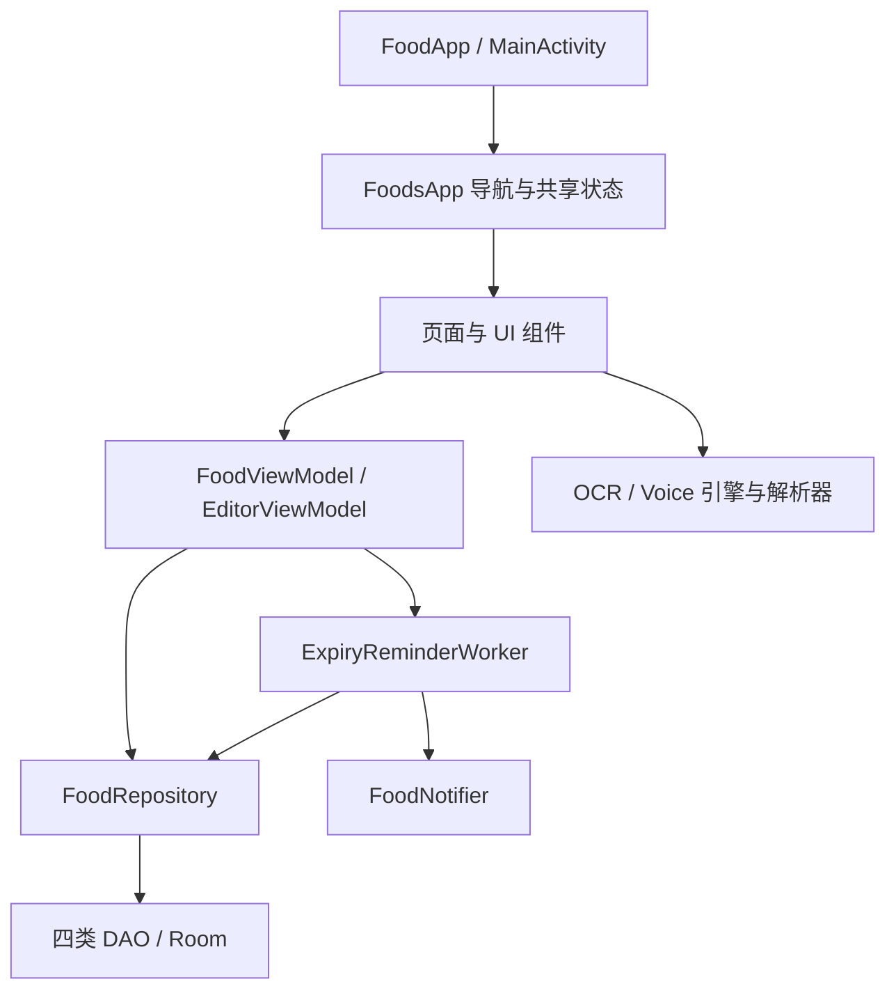

**食物管家（FoodManager）项目综合评估报告**

评估日期：2026-10-01（北京时间）。评估对象为当前工作区，包含尚未提交的代码、数据库 schema 和文档。本次只新增分析报告，没有修改业务代码。

**一、核心结论**

这是一个定位清晰、核心流程完整的 Android 本地食物管理 MVP。它已具备进一步打磨的基础：原生 Compose 界面、Room 持久化、多方式录入、离线识别、临期提醒和归档恢复。适合继续面向单人或家庭中的主要管理者迭代。

当前最主要的短板是“功能可用”与“长期可靠”之间的差距。页面状态、保存确认、时间刷新、数据库升级及权限承诺存在具体问题。UI 有统一的暖色品牌方向，但信息层级、文字可读性和操作密度仍需要调整。建议先修复可靠性，再优化录入效率与视觉细节，暂不进行大规模架构重写。

按产品阶段判断：**功能完整的 MVP，具备内部试用价值，尚不足以仅凭现有验证认定为稳定的正式发行版。** 这不是对技术选型的否定，而是对当前交付证据和失效场景的判断。

以下分数是基于代码证据的专家判断，满分 5 分；1 表示明显欠缺，3 表示基本具备但有实质缺口，5 表示完整且经过验证。它们不是行业排名、用户满意度或量化质量认证，不合成为一个掩盖高风险问题的总分。

| 维度 | 判断 | 评分 | 依据与边界 |
|---|---|---:|---|
| 产品定位与功能闭环 | 清晰 | 4 | 录入、查找、提醒、归档齐全；真实持续使用效果未测 |
| UI 风格一致性 | 有基础 | 3 | 品牌色、字体、Material 组件统一，语义色和页面背景未完全统一 |
| 易用性与任务效率 | 中等 | 3 | 三种录入方式与手工兜底好，入口重复、表单密度和规则差异增加负担 |
| 无障碍与适配 | 较弱 | 2 | 小字状态色对比不足，按住语音缺少明确辅助操作语义 |
| 架构可维护性 | 中等 | 3 | 基本分层成立，但共享状态、Android 依赖和识别编排耦合偏高 |
| 技术选型适配性 | 较好 | 4 | 原生 UI、数据库、后台任务和本地识别符合定位 |
| 工程与发布成熟度 | 较弱 | 2 | 单测有基础，迁移、生命周期、发布配置和持续集成证据不足 |
| 数据可靠性 | 有显著缺口 | 2 | 有正式迁移，但旧 SQLite 删除列策略有问题，保存前清表单 |
| 隐私承诺可验证性 | 有显著缺口 | 2 | 离线计算成立，但正式版合并清单仍有 INTERNET，系统备份边界未说清 |
| 性能与资源意识 | 有基础 | 3 | 有图片缩放、回收和后台处理；无真机性能数据，模型与安装包较大 |

**二、评估范围与证据强度**

检查了 38 个生产 Kotlin 文件，共约 9,428 行（包含注释和空行），以及构建配置、Manifest、数据库迁移、测试、现有产品和技术文档。重点追踪首页、库存、录入、编辑、设置、归档以及 OCR、语音、提醒链路。

证据分三类：

- **代码确认**：能从当前调用链、条件分支、配置直接证明的问题；不代表已经在手机上复现。
- **静态风险**：代码存在导致问题的条件，但发生频率、设备表现或并发结果仍需测试。
- **待实测**：视觉实际布局、真机识别率、性能、系统通知到达率与真实用户行为。

本次没有启动手机或模拟器，没有浏览实际页面截图，没有进行 TalkBack、横屏、大字体、厂商后台限制、真实拍照和语音样本实验。因此，UI 评价来自实际界面代码与颜色计算，不能替代真机视觉验收；没有编造识别准确率、留存率、竞品市场份额或性能数值。

**三、产品定位、业务价值与行业通用分析方法**

产品要完成的工作很明确：帮助用户知道“家里有什么、放在哪里、什么时候需要处理”。不注册和本地识别降低了账号与网络门槛。主要用户画像应先限定为“愿意维护库存的个人或家庭主要采购者”，不能因为使用场景在家庭中，就默认已经满足多人共享需求。

最关键的产品风险是维护成本：用户买入时录一次，消费时还要更新；如果录入和扣减太麻烦，库存很快会与现实脱节。三种输入方式只有在“识别后修改成本低于手填”时才真正创造价值。下一阶段应衡量完成任务的时间和修正次数，而不是继续增加入口数量。

| 通用方法 | 本项目如何使用 | 应得到的结果 |
|---|---|---|
| JTBD / 用户任务分析 | 买完东西入库、做饭前查库存、处理临期食品、用完扣减 | 明确高频任务及阻力，而非仅列功能 |
| 用户旅程与认知走查 | 初次打开→授权→录入→核对→入库→收到提醒→归档 | 每一步是否能理解下一步、是否有退路 |
| Nielsen 可用性启发式 | 检查状态反馈、术语、撤销、一致性、防错和帮助 | 可复查的问题清单，而非主观“好不好看” |
| 任务可用性测试 / SUS | 找用户完成固定任务，记录成功率、耗时、错误，再收问卷 | 实际易用性数据；本次未实施，不提供虚构分数 |
| HEART / 任务漏斗 | 满意度、采用率、留存、任务成功；工具类不追求长时间停留 | 关注“有用地完成任务”，避免把停留时长当价值 |
| 风险优先的工程评审 | 升级失败、草稿丢失、错误提示、通知失效 | 先修高影响故障，再做样式微调 |
| 性能预算与质量门禁 | 启动、识别耗时、内存、包体、回归测试 | 可执行的发行标准 |

启发式评价参考 [Nielsen Norman Group 的十项可用性原则](https://www.nngroup.com/articles/ten-usability-heuristics/)。本报告据此检查反馈、一致性和恢复能力；它不能替代用户测试。

不做未经验证的具体竞品排名，先用替代方案检验价值主张：

| 替代方案类别 | 本项目可能的优势 | 本项目需要补足或明确的边界 |
|---|---|---|
| 纸笔、便签、通用备忘录 | 结构化日期、位置查找、自动提醒 | 录入不能明显慢于写便签 |
| 通用库存工具 | 食物语义、临期信息、多方式输入 | 消费更新和批量维护要足够顺手 |
| 具备共享能力的家庭工具 | 无账号、本地计算 | 当前单机定位不解决多人实时协作 |
| 包含采购、菜谱的综合工具 | 功能集中、学习范围较小 | 需要证明“减少遗忘”本身足以促成持续使用 |

这些是能力类别比较，不是已完成的市场调查。云同步、导出、共享和国际化在现有需求中明确不做，本报告不把它们当成必须补齐的缺陷。只有目标用户改变时，才重新评估范围。

建议开展 5–8 人的形成性测试，包含新用户、经常采购者及大字体用户。固定任务：录入 5 件商品、修正一个错误日期、找到某位置的临期食品、消费半份食品、恢复误归档条目。记录完成率、中位耗时、修正次数、求助次数；该样本用于发现问题，不用于统计代表性结论。

**四、UI 风格、视觉层级与样式**

现有风格可描述为“温暖、生活化的 Material 工具界面”：橙棕主色 `#B4531A`，保鲜绿 `#2E6B4F`，米色背景 `#FFF8F5`，卡片式布局、圆角、底部四标签导航。中文标题 22/30sp，正文 16/24sp 与 14/21sp，有明确的字体层级，也提供浅深主题。这比完全依赖默认模板更有产品辨识度。

不过，主题已经设计了较深的 WarnAmber/FreshGreen，实际状态卡片却使用另一组固定 StatusColors。两套颜色体系并存，造成“品牌色成熟、状态字色偏浅”的问题；这些固定色也没有针对深色主题单独调整。

按状态标签代码，将前景色以 14% 透明度叠加在浅色卡片 `#FFFBFF` 上，计算文字与标签背景的 sRGB 对比度：

| 状态 | 前景色 | 计算对比度（约） | 对小字号文字的判断 |
|---|---|---:|---|
| 已过期 | `#D32F2F` | 3.94:1 | 低于 4.5:1 |
| 临期 | `#E8A33D` | 1.91:1 | 明显不足 |
| 新鲜 | `#3E9C6E` | 2.86:1 | 不足 |
| 无保质期 | `#8A8A8A` | 2.93:1 | 不足 |

这里使用 [W3C 对比度标准](https://www.w3.org/WAI/WCAG21/Understanding/contrast-minimum)作为原生应用的可读性参考：普通文字以 4.5:1 为目标。上述结果是代码颜色计算，不是整款 App 的无障碍认证，也未覆盖深色模式。状态同时有文字和颜色是优点，应保留。

| 页面/组件 | 优点 | 主要问题 | 建议 |
|---|---|---|---|
| 首页 | 状态概览、快捷录入和提醒都可见 | 四张统计卡加三种录入入口，紧急任务排在较后；11sp 文案较多 | 首屏突出“今天需要处理”，统计适当弱化；统计可跳转对应筛选 |
| 库存 | 搜索覆盖名称、分类、位置、备注；有列表稳定 key | 每卡五个操作，重复显示编辑入口；位置 FlowRow 多时占用列表空间 | 优先保留消费/编辑，将删除收进更多菜单；位置筛选可折叠 |
| 录入 | 三种方式互斥展开，手工可兜底 | 长表单、草稿、原文同时堆叠；入库前检查成本高 | 必要字段优先，其他字段渐进展开；缺失日期优先提示 |
| 编辑 | 能复用手工、图片、语音组件 | 表单状态与 ViewModel 状态分离，行为一致性没有真正落实 | UI 重构前先统一数据来源和保存流程 |
| 设置 | 分组合理，有归档与自定义位置 | 678 行大文件；用户选项和 OCR 诊断信息混杂 | 诊断内容折叠到“帮助与诊断”；保留核心选项易达 |

视觉细节建议：将间距集中成 4/8/12/16/24/32dp 等少量令牌；统一卡片与页面背景；核心状态字提升到约 14sp；色条使用随内容伸展的高度，而非固定 112dp；检查长名称、大字体和 320–360dp 宽度下的布局。现有字体体系可继续使用，无需为了风格另行引入字体包。

库存、首页等内层 Scaffold 未像录入页一样显式统一背景；手工表单使用的 tertiaryContainer 也未在主题中显式定义。建议补齐语义色，而不是在页面继续增加局部颜色常量。

**五、易用性与信息语义**

1. **不要把“日期未填写”描述成“无保质期”。** 当前 null expiryDate 被展示为“无保质期”，用户可能误以为无需担心过期；实际上只是没有记录日期。建议改成“未设置到期日”，支持筛出待补全信息。“新鲜”也更准确地表达为“未临期”，因为应用只知道录入日期，没有实际储存状态信息。
2. **数量零与数量未知混用。** 列表把 0 解释成未填写，但减一可把 1 减到 0，随后隐藏数量、仍留在库存。应明确区分未知、剩余为零与归档；数量为零时提供归档建议，避免直接假设一定用完。
3. **单位与扣减步长不匹配。** Double 支持 0.5 千克，但卡片仅提供 ±1，减一会直接归零。可提供“修改剩余数量”或按单位设置步长。不要只优化按件计数。
4. **入口重复且结果不同。** 库存顶部加号去拍照录入，悬浮“添加食物”去编辑页；同一页的新增符号行为不同，用户难以预测。建议一个主新增入口，再选方式。
5. **位置校验存在三种策略。** 手工录入拦截、编辑页允许确认后留空、识别草稿可直接留空。文档虽然认可部分差异，但用户仍要学习多套规则。保持“不自动套用位置”的既定需求，将留空策略清晰统一或明确说明。
6. **权限请求偏早。** 启动即请求录音和通知，用户还没选择语音。应在开始语音时解释录音用途，在建立第一条提醒时说明通知价值；设置页应显示系统实际授权状态和渠道关闭状态。
7. **恢复路径偏深。** 用完需确认，恢复又要进入设置的归档；可逆的高频动作更适合即时完成后提供撤销，永久删除仍保留确认。待入库“清空”当前直接清空，应提供撤销或确认。
8. **按住说话依赖触摸手势。** 使用 pointerInput，未见对应的可访问点击动作；仅给图标描述不等于提供可操作语义。增加可访问的“开始/结束”替代操作，并测试 TalkBack、键盘和开关控制。
9. **“置信度百分比”表达过强。** 解析器按命中字段累加常量，不是经过校准的识别正确概率。建议改为“已识别字段/待核对字段”，尤其突出日期来源，避免用户把 90% 理解为安全保证。

**六、架构与耦合度分析**

当前是单 app 模块、按技术职责分包的分层结构，大致为：

**总体判断：结构上的分层中等，行为上的耦合中等偏高。** 不是无组织的代码堆积，但也不是文档所描述的严格单向、独立能力完全隔离。单模块本身不是缺陷，约 9,400 行的项目无需先拆出许多 Gradle 模块。

| 耦合点 | 实际表现 | 影响 |
|---|---|---|
| 全局共享 ViewModel | 库存、统计、设置、别名、归档都在 FoodViewModel | 修改一个领域容易触碰不相关页面；首页还读取了库存筛选后的 items |
| 数据层暴露平台 Context | Repository.appContext() 被 ViewModel 用来调 WorkManager | 数据访问和平台调度职责混合，测试需要处理更多 Android 依赖 |
| 双重表单状态 | EditorViewModel.item 与 ManualEntryState.item 并存 | 识别、异步加载、手工修改可能只更新其中一份 |
| UI 负责识别编排 | PhotoInputCard 包含权限、文件、图像处理、解析和反馈 | 相机/相册链路出现参数与线程策略差异，已有实际缺陷 |
| Repository 职责跨度 | 食物、设置、位置、词库、统计都在同一类 | 当前尚能理解，但缺少清晰业务边界 |
| 手写导航生命周期 | 状态编码、编辑 ViewModel key 和返回行为自行管理 | 已出现编码冲突；整个项目未发现 BackHandler，系统返回路径需验证 |
| 领域模型边界 | FoodItem 同时是 Room entity、表单状态和业务数据 | 小项目合理，但 UI 可以直接构造未校验的持久化对象 |
| 时间依赖分散 | 多处直接 DateUtils.today()，刷新 Flow 没接入 | 测试跨天困难、不同页面状态可能不一致 |

值得保留：DAO 接口、Flow 驱动、collectAsStateWithLifecycle、稳定列表 key、明确 FoodDraft、手工状态抽取、迁移 schema 导出、识别文本与解析分离。Android 官方也建议 UI 状态由状态持有者暴露、UI 按生命周期收集；这些方向已经采用。[Android 架构建议](https://developer.android.com/topic/architecture/recommendations)

建议的演进是按故障边界小步拆分：

- 先确定编辑页唯一状态源，定义 Loading / Ready / Saving / Error 等状态；成功后再清空和退出。
- 抽出共用的识别入口服务，让拍照与相册传递相同模式、词表和错误处理。
- 把提醒调度封装为 ReminderScheduler，把日期封装为可替换的 Clock/DateProvider。
- 将 Settings/词库与库存行为逐步分离；可先在同模块内做，不强制引入完整 Clean Architecture 或依赖注入框架。
- 导航可继续手写，但必须有唯一页面编码、正确 ViewModel 生命周期和返回测试。只有路由增长时再评估 NavHost。

以上是建议方案，不是已实施的架构决策；不需要为了符合模式而重写解析器或拆分微服务。

**七、已发现问题与优先级**

P0：公开发行/升级前必须解决的高影响问题。P1：核心任务可靠性或信任问题，下一轮优先。P2：体验、性能与维护改进。优先级不是说每位用户都已遭遇问题。

| 编号 | 优先级/证据 | 问题、触发条件与影响 | 处理及验收 |
|---|---|---|---|
| F01 | P0，代码确认的兼容路径缺陷 | 迁移在不支持 DROP COLUMN 的 SQLite 上吞掉异常，旧列仍在；Room 2.7.2 TableInfo 明确比较列集合，生成代码也进行表结构相等检查。“多列会被忽略”的注释错误，旧库升级可因校验失败无法打开 | 采用建新表→复制列→替换表的兼容迁移；覆盖 v1–v7→v8、最低支持系统和真实旧数据 |
| F02 | P1，配置确认 | 正式版和 Debug 合并清单均含 INTERNET；来源是 transport-backend-cct:2.3.3，文档“不申请网络权限”不成立 | 查清依赖用途；若坚持无联网权限则显式移除并回归全部识别功能。验收最终发行包，不只看源码 Manifest。未发现实际上传证据 |
| F03 | P1，代码确认 | 首页条件为“横幅开启且有 alerts”，否则库存非空就显示“暂时没有临期或过期食物”。关闭横幅但存在临期项时显示错误结论 | “无临期”仅依赖 alerts 为空；横幅开关仅控制显示，不改变事实 |
| F04 | P1，代码确认 | todayFlow 被写入但未参与 stats/alertItems 的 combine；库存 today 又被 remember 固定。持续停留跨午夜没有有效刷新源 | 日期变化与返回前台触发统一状态重算；固定时钟测试跨午夜、跨月和时区变化 |
| F05 | P1，代码确认 | FullScreenSaver 用 0 同时保存 Archived 与 Editor(0)，恢复时一律归档 | 使用带类型的保存格式；新增页旋转和进程恢复仍停在新增页 |
| F06 | P1，代码确认 | 编辑表单 form 在异步加载前记住初始 item；之后加载和 OCR/语音只更新 ViewModel，保存校验却读取 form | 使用唯一状态源；已有位置的记录不应被提示位置为空，识别填值后校验必须读取新值 |
| F07 | P1，代码确认/失败场景待测 | 手工保存启动异步写库后立即清空表单并显示成功；ViewModel 写库未统一捕获错误 | 写库确认后再清空；失败保留所有输入并可重试，模拟磁盘/数据库异常 |
| F08 | P1，代码确认 | 相机调用 handleResult 传 singleItemMode，相册走 recognizeAndParse，最终用解析器默认 false；同一图片可能因入口不同被拆分 | 统一解析配置，使用同图对比相机与相册结果；同时接通常用食品词表，当前 OCR UI 调用未传 extraKeywords |
| F09 | P1，静态生命周期风险 | scanState 仅 remember：进程回收、Activity 重建会失去表单与草稿。editor-0 ViewModel 挂在 Activity 的 store 且重复使用，退出新增后再次进入可能保留旧内容并再次新增 | 草稿视需求用 SavedStateHandle 或本地草稿表；限定编辑会话生命周期；测试旋转、离开返回、第二次新增 |
| F10 | P1，代码确认/系统行为待测 | 每日 WorkManager 周期任务不能保证所选整点；通知设置开关只表示 App 设置，不代表系统允许。立即检查返回的是命中数量，不是通知送达证明 | 文案改为“约在此时检查”；显示实际系统授权/渠道状态；验证省电、重启、改时间和关闭权限 |
| F11 | P1，代码确认 | 某类提醒为空但另一类非空时，FoodNotifier 不取消已消失类别的旧通知；归档、删除后也未统一触发通知刷新 | 每类通知独立刷新或取消；过期项处理完后不能保留过期通知 |
| F12 | P1，代码确认 | 小字号状态标签对比度不足；未知日期被描述成无保质期 | 按浅深主题定义前景/容器色；调整日期文案，复测对比度及读屏 |
| F13 | P2，静态并发风险 | 数量变更先读再写；设置也整行读改写，无统一事务/串行化保护 | 快速连续加减和连续修改不同设置时可能丢更新；采用原子 SQL 或事务串行化并验证 |
| F14 | P2，静态风险 | 批量入库、编辑保存未见 isSaving 防重复提交；可多次触发插入 | 保存中禁用重复动作，提交使用快照和明确会话；连点后只落一份 |
| F15 | P2，代码确认 | clearAll 只删 food_items，位置、词库、设置和内存草稿保留，但按钮叫“清空全部数据” | 改成“清空全部食物记录”，或明确区分恢复初始状态，不悄悄扩大删除范围 |
| F16 | P2，代码确认/设备性能待测 | 相册 OCR 路径没有像拍照一样统一后台解码与 finally 回收原图；本地大图可能增加主线程工作和内存峰值 | 共用后台识别管线；大图、连续选图与取消识别做内存测试 |
| F17 | P2，静态日期风险 | 用毫秒差除 24 小时表示自然日，跨夏令时可差一天；日期按本地零点存储也受时区更改影响 | 定义纯日期语义；评估 LocalDate/epochDay 及兼容方案，不直接批量改历史值 |
| F18 | P1，Lint 与代码确认 | MainActivity 在 composition 中直接读取 openAlerts.value，没有订阅其变化；App 已打开时通过 onNewIntent 收到通知意图，可能不能及时导航 | 按生命周期收集通知导航状态；分别测试冷启动和前台/后台已有 Activity 时点击通知 |
| F19 | P2，Lint 告警确认 | AudioRecord 构造被标记 MissingPermission；调用外围已有 runCatching，因此不能直接断言未授权必然崩溃，但权限拒绝可能被误报为麦克风占用 | 在实际开始录音前再次检查权限，区分拒绝、撤销与设备失败；回归权限撤销并消除检查错误 |

F01 已核对本机缓存中的 Room 2.7.2 源码与当前生成的 AppDatabase_Impl；未在旧系统安装复现。不能把“没有破坏式迁移”直接等同于“升级必然不丢数据或必然成功”。官方提供迁移测试方法，应补充针对现有 Room 版本的测试依赖与升级数据用例。[Room 数据迁移测试](https://developer.android.com/training/data-storage/room/migrating-db-versions)

F10 的时序限制是后台调度机制的性质：系统优化和约束决定实际执行时间。对于临期提醒，接受合理延迟通常是可行取舍，应先调整承诺与测试，不必直接引入精确闹钟权限。[WorkManager 周期任务说明](https://developer.android.com/develop/background-work/background-tasks/persistent/getting-started/define-work)

**八、技术成熟度、性能与数据治理**

技术栈与需求匹配度较高。Compose/Material 3 适合原生表单工具，Room/Flow 适合本地结构化数据，WorkManager 适合可延迟的提醒检查，ML Kit 中文内置模型与 Vosk 满足无网络也能识别的方向。但“采用成熟组件”不等于“系统已经成熟”：当前问题主要发生在组件衔接与生命周期，而非缺少框架。

版本配置包括 AGP 9.4.1、Kotlin 2.2.10、Room 2.7.2、WorkManager 2.9.0、Compose BOM 2026.02.01，其他 AndroidX 版本跨多个时期。这里不据版本号直接判定过时或存在漏洞，也未完成依赖安全公告审计。应建立兼容组合和升级节奏；本次实际构建已暴露 JDK 目标回退与不支持的编译参数警告。

现有 Debug APK 为 106,177,936 字节，约 **101.3 MiB**；语音模型资产为 68,292,271 字节，约 **65.1 MiB**。这是当前本地产物数据，不是 Release 下载体积、安装后占用或运行内存。首次使用还会解包模型，因此包内资产、解包文件和运行模型需分别预算。

优势包括：模型放 noBackupFilesDir、相机临时图清理、缩放识别图片、相机路径显式回收、列表使用 LazyColumn。问题包括：全量库存读取后内存过滤，多个 Flow 重复派生；food_items 缺少查询索引，但常用位置/食品表实际上有 name 唯一索引，所以“数据库完全没有索引”的表述不准确。

不要在小库存时立即引入分页或全文搜索。先用 100/1,000/10,000 条记录测量搜索和排序，再决定是否下推查询、合并 UI 状态、增加 archived/expiryDate 等索引。前后通配 LIKE 不能靠普通 B-tree 自动获得理想优化。

隐私上需要区分三个概念：**识别可离线、应用是否拥有联网能力、数据是否可能由系统备份迁移。** Manifest 设置 allowBackup=true，两份备份规则仍接近默认模板，并未显式限定“只备份数据库”。系统备份边界受设备与系统设置影响；无自建服务器不代表数据永远不会通过系统机制离开手机。建议准确说明系统备份，显式定义备份范围并验证恢复。没有证据证明图片或录音已经上传，不作该结论。

单机应用最重要的数据治理问题是可恢复性。既然导出/导入当前明确不做，应至少验证系统备份恢复和升级兼容，并清楚提示能力边界。用户自定义常用位置用字符串关联库存是合理简化；代价是不能自动保持重命名一致、别名也可能冲突。可增加冲突提示，无需立刻把所有历史位置强制改外键。

当前 archived 布尔值无法区分“吃完”和“丢弃”，因此未来若增加减少浪费的成效统计，需要新增处置原因与时间。现在不能从归档数量推断实际减少了多少浪费。

**九、测试、可观测性与交付能力**

本次使用当前工作区强制重新执行 `:app:testDebugUnitTest --offline --rerun-tasks`，成功完成 **59 项测试，0 失败、0 错误**：解析 44 项、位置/别名/清洗 12 项、编码 2 项、示例 1 项。位置测试不是 SQLite 迁移集成测试，59 项通过不能覆盖 F01–F19。

编译并非文档所说的“0 警告”：实际出现 `-Xsource-charset=UTF-8` 不受支持、Kotlin 对 JDK 25 目标回退及实验选项警告。中文编码测试通过是有效证据；不受支持的参数不能作为编码保障依据。

当前测试结构主要保护纯文本解析，缺少有力的 Room 迁移、ViewModel 写库失败、Compose 页面交互、进程恢复、通知生命周期及性能回归。语音设备测试包含无条件 assertTrue 与权限不足跳过场景，属于有限冒烟验证，不能证明识别率或异步识别成功。

未发现仓库中的持续集成配置；不推断外部完全没有流水线。Release 配置关闭优化，仍用 com.example 命名，versionCode=1，生产发布准备需要单独验收。没有必要马上加入云端日志或分析 SDK；离线定位下可以先做本地诊断、测试构建报告和用户主动提供的脱敏日志。

本次也执行了 `:app:lintDebug`：**2 项错误、24 项警告，检查未通过**。两项错误分别是 VoiceRecognizer.kt:183 的 MissingPermission 和 MainActivity.kt:39 的 StateFlowValueCalledInComposition，已纳入 F19/F18。警告主要涉及依赖版本提示、ExifInterface、Compose 参数约定、未使用资源及 ABI 支持。版本提示不直接等于安全漏洞，ARM-only 也可能是有意的范围选择，不能将全部警告一概按产品故障处理。

检查首次因离线缺少依赖未能执行，之后允许解析依赖并完成检查；上面的 2/24 是最终检查结果，不是环境失败数量。`:app:processReleaseMainManifest` 已成功运行并再次确认正式版权限来源；没有执行正式版签名、发布，也没有安装 App。

现有文档需同步修正：“0 警告”“不申请网络权限”“多余列会被 Room 忽略”“系统备份仅覆盖数据库”等描述与本次证据不符；编辑页恢复也应区分“恢复页面身份”与“恢复未保存表单内容”。

**十、建议实施顺序与验收标准**

| 阶段 | 内容 | 必须达到的结果 |
|---|---|---|
| A：发行前可靠性 | F01 迁移、F02 权限承诺、F03–F08 状态与保存、F11 通知清理 | 老库可升级；事实提示准确；保存失败不丢输入；相机相册行为相同 |
| B：生命周期和交互 | 草稿恢复、编辑会话、系统返回、重复提交、授权状态、数量语义 | 旋转/回收/返回/连点后仍正确；关键操作可理解、可恢复 |
| C：UI 与效率 | 状态颜色、字级、库存操作密度、表单渐进披露、设置分组 | 小屏与大字体可用；完成核心任务更快，且没有增加误操作 |
| D：工程固化 | 自动测试、性能预算、Release 构建、备份恢复、文档更新 | 从干净环境能复现构建；形成可重复的发行检查 |

建议的新增验收用例：

- 旧库各版本升级，含用户已删光常用项、特殊字符、空设置等数据；记录和设置保持预期。
- 保存失败时保留输入；连续点击入库只提交一次；成功提示必须晚于写库成功。
- 页面一直开启跨午夜；后台跨天后返回；首页统计、库存状态、提醒一致。
- 新增页旋转、进程重建、返回再新增；不能跳归档、保留错误会话或重复插入。
- 同图从相册与相机输入，在单件/拆分两种模式下得到相同解析策略。
- 两类通知同时存在后，删除其中一类的最后一条；旧通知及时取消。
- 关闭系统通知或某通知渠道，App 显示真实可达状态；勿把“检查成功”写成“已送达”。
- 0.5 千克、未知数量、数量归零；行为符合定义，不能隐藏错误库存。
- 浅色/深色、大字体、长名称、TalkBack、键盘导航；可读、可操作、不遮挡。
- 断网、首次模型加载、低存储、大照片连续处理、取消识别、系统备份恢复。

产品指标建议先建立基线，再设目标：首次成功入库率、每件录入耗时、识别后字段修改率、日期人工核对率、通知后处理率、7/30 天有效使用情况。遵循现有离线定位，优先通过受控测试和用户自愿反馈收集，不默认接入追踪。

**十一、代码证据索引**

下列链接定位本次评估快照；后续修改可能导致行号变化。

| 对应问题/主题 | 主要证据 |
|---|---|
| F01 迁移与吞异常 | [DatabaseMigrations.kt](C:/Users/zhanghr/AndroidStudioProjects/FoodManager/app/src/main/java/com/example/foodmanager/data/DatabaseMigrations.kt:172) |
| F02 正式版权限来源 | [Release Manifest 合并报告](C:/Users/zhanghr/AndroidStudioProjects/FoodManager/app/build/outputs/logs/manifest-merger-release-report.txt:862) |
| F03 首页条件 | [HomeScreen.kt](C:/Users/zhanghr/AndroidStudioProjects/FoodManager/app/src/main/java/com/example/foodmanager/ui/HomeScreen.kt:122) |
| F04 时间刷新、F13 并发 | [FoodRepository.kt](C:/Users/zhanghr/AndroidStudioProjects/FoodManager/app/src/main/java/com/example/foodmanager/data/FoodRepository.kt:47) |
| F05 页面编码、F09 会话 | [FoodsApp.kt](C:/Users/zhanghr/AndroidStudioProjects/FoodManager/app/src/main/java/com/example/foodmanager/ui/FoodsApp.kt:225) |
| F06 编辑双状态 | [EditorScreen.kt](C:/Users/zhanghr/AndroidStudioProjects/FoodManager/app/src/main/java/com/example/foodmanager/ui/screens/EditorScreen.kt:92) |
| F07 提前成功、F14 入库 | [ScanScreen.kt](C:/Users/zhanghr/AndroidStudioProjects/FoodManager/app/src/main/java/com/example/foodmanager/ui/screens/ScanScreen.kt:260) |
| F08/F16 相册分支 | [PhotoInputCard.kt](C:/Users/zhanghr/AndroidStudioProjects/FoodManager/app/src/main/java/com/example/foodmanager/ui/components/PhotoInputCard.kt:200) |
| F10 提醒调度 | [ExpiryReminderWorker.kt](C:/Users/zhanghr/AndroidStudioProjects/FoodManager/app/src/main/java/com/example/foodmanager/notify/ExpiryReminderWorker.kt:48) |
| F11 通知类别处理 | [FoodNotifier.kt](C:/Users/zhanghr/AndroidStudioProjects/FoodManager/app/src/main/java/com/example/foodmanager/notify/FoodNotifier.kt:69) |
| UI 颜色和字级 | [Color.kt](C:/Users/zhanghr/AndroidStudioProjects/FoodManager/app/src/main/java/com/example/foodmanager/ui/theme/Color.kt)、[Type.kt](C:/Users/zhanghr/AndroidStudioProjects/FoodManager/app/src/main/java/com/example/foodmanager/ui/theme/Type.kt) |
| 状态标签和操作密度 | [FoodCard.kt](C:/Users/zhanghr/AndroidStudioProjects/FoodManager/app/src/main/java/com/example/foodmanager/ui/components/FoodCard.kt:54) |
| 依赖与发布配置 | [app 构建配置](C:/Users/zhanghr/AndroidStudioProjects/FoodManager/app/build.gradle.kts)、[版本目录](C:/Users/zhanghr/AndroidStudioProjects/FoodManager/gradle/libs.versions.toml) |
| 本次单测结果 | [单元测试报告](C:/Users/zhanghr/AndroidStudioProjects/FoodManager/app/build/reports/tests/testDebugUnitTest/index.html) |
| F18 通知导航状态 | [MainActivity.kt](C:/Users/zhanghr/AndroidStudioProjects/FoodManager/app/src/main/java/com/example/foodmanager/MainActivity.kt:39) |
| F19 录音权限检查 | [VoiceRecognizer.kt](C:/Users/zhanghr/AndroidStudioProjects/FoodManager/app/src/main/java/com/example/foodmanager/voice/VoiceRecognizer.kt:183) |
| 本次静态检查 | [Lint 报告](C:/Users/zhanghr/AndroidStudioProjects/FoodManager/app/build/reports/lint-results-debug.html) |

最值得保留的是明确的本地工具定位和已有业务闭环。下一轮迭代应让用户能够放心地录入、保存、升级和依赖提醒，再用任务测试决定哪些页面需要精简。
